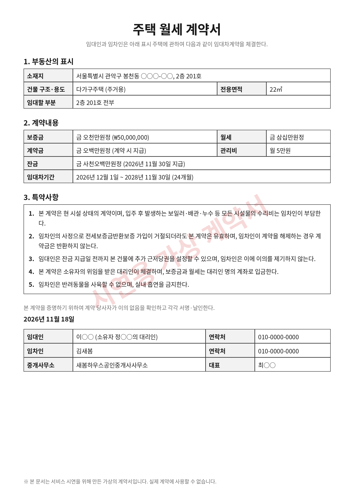
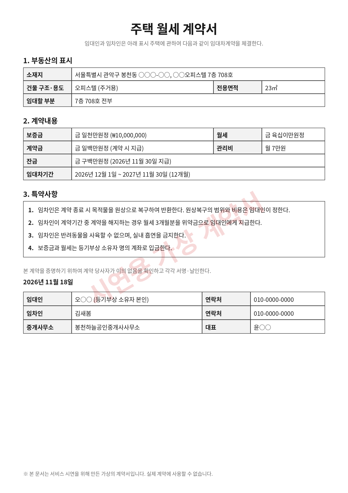
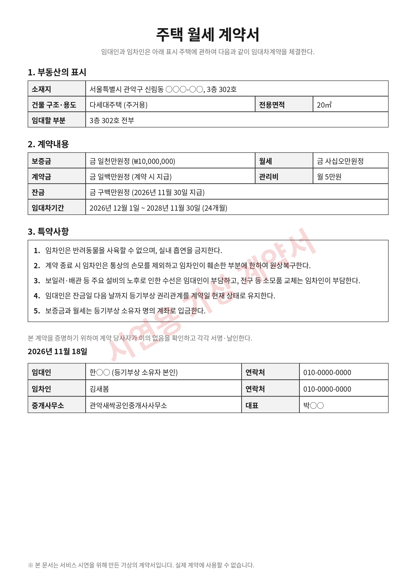

# 🏠 SafeHome 청년 비서

**사회초년생 첫 자취방 안심계약 도우미**

🏆 2026 유한대학교 AWS KIROTHON 우수상

> 2026 유한대학교 AWS KIROTHON 해커톤에서 **약 2시간 동안 4인 팀으로 만든 MVP**입니다.

계약서 사진 한 장과 확인 질문 8개로 **독소조항·사기 신호·주변 시세·중개사 등록**을 분석해 🟢 🟡 🔴 **계약 신호등**으로 알려 주고, 받을 수 있는 주거 지원금과 문제가 생겼을 때의 대처 방법까지 안내하는 웹 서비스입니다.

## 📋 목차

- [기획 배경](#-기획-배경)
- [주요 기능](#-주요-기능)
- [시연 시나리오](#-시연-시나리오)
- [기술 스택](#-기술-스택)
- [프로젝트 구조](#-프로젝트-구조)
- [실행 방법](#-실행-방법)
- [개발 방식](#-개발-방식-kiro-steering)
- [팀원](#-팀원)

## 💡 기획 배경

첫 월세방을 구하는 사회초년생은 등기부등본이나 특약을 읽어 본 적이 없어 "중개사 말만 믿어도 될까?" 하고 불안해합니다.

| 어려움 | 예시 |
|---|---|
| 계약서 특약이 불리한지 모름 | 수리비 전부 전가, 과도한 위약금, 보증금 반환 책임 회피 |
| 사기 신호를 놓침 | 가짜 집주인·대리 계약, 신탁 등기, 미등록 중개사, 시세보다 싼 미끼 매물 |
| 확인할 정보가 흩어져 있음 | 등기부·건축물대장·시세·지원금이 사이트마다 따로 |
| 문제가 생기면 어디에 연락할지 모름 | 임차권등기명령, 피해 지원 신청 절차를 몰라 대응이 늦어짐 |

전세사기 피해자는 2026년 3월 기준 누적 약 3.8만 명입니다 (출처: KB Think, 2026.7).

## ✨ 주요 기능

| 단계 | 내용 |
|:--:|---|
| 1. 정보 입력 | 나이·소득·지역·직업, 계약 전 확인 질문 8개 (등기부 소유자 일치, 신탁·압류, 근저당, 입금 계좌, 대리 계약 등) |
| 2. 계약서 업로드 | 사진 한 장을 올리면 AI(Gemini)가 특약 문장을 직접 판독 |
| 3. 계약 신호등 | 특약 위험도, 사기 신호, 주변 시세(관악구 실거래 데이터), 중개사 등록 여부를 종합해 🟢 준비 완료 / 🟡 조건부 진행 / 🔴 계약 보류 판정 |
| 4. 다음 행동 | 수정 특약 문구 복사, 받을 수 있는 지원금 매칭, 계약 후 할 일 체크리스트, 전월세 사기 피해 대처 가이드(`/guide`) |

### 차별점

- **AI가 특약을 읽고 수정 문구까지 제안**합니다.
- **공공데이터로 시세와 중개사 등록을 확인**합니다.
- **숫자 판정은 AI 대신 코드로** 합니다. 나이·소득·비율 같은 판정을 코드(`lib/verdict.ts`, `lib/price.ts`, `lib/grants.ts`)로 처리해 결과의 근거를 설명할 수 있습니다.

## 🎬 시연 시나리오

위험 → 애매 → 안전 순서로 시연합니다. 시연용 계약서는 [`docs/samples/`](docs/samples)에 있습니다.

| 🔴 위험한 집 → 계약 보류 | 🟡 애매한 집 → 조건부 진행 | 🟢 안전한 집 → 준비 완료 |
|:--:|:--:|:--:|
|  |  |  |
| 시세보다 30% 싼 월세, 수리비 전가 특약, 소유자 불일치·신탁 → 사기 신호 + 대처 가이드 | 시세 +18%, 위약금 3개월분 특약 → 수정 특약 문구 제안 | 필수 항목 모두 통과 → 계약 후 할 일 + 받을 수 있는 지원금 |

위험한 집 계약서에 숨어 있는 위험 신호 4가지:

1. 보일러·누수까지 모든 수리비를 임차인이 부담 → **수선의무 전가**
2. 보증보험 가입이 거절돼도 계약금 반환 불가 → **보증금 보호 불가**
3. 잔금 전까지 추가 근저당 설정 허용 → **깡통 위험**
4. 소유자 대신 대리인이 계약, 대리인 계좌로 입금 → **사기 의심 신호**

## 🛠 기술 스택

| 구분 | 기술 |
|---|---|
| Framework | Next.js 16 (App Router), React 19, TypeScript |
| Style | Tailwind CSS 4, lucide-react |
| AI | Google Gemini API (`@google/generative-ai`), 이미지 판독 |
| Validation | Zod (AI 응답 스키마 검증) |
| Data | JSON (`web/data/`: 관악구 월세 시세, 중개사 등록 목록, 지원금) — DB 없음 |
| AI 개발 도구 | Kiro (steering 규칙 기반 개발) |

## 📁 프로젝트 구조

```
web/
├── app/
│   ├── page.tsx              # 입력 → 업로드 → 결과 화면
│   ├── guide/page.tsx        # 전월세 사기 피해 대처 가이드
│   └── api/analyze/route.ts  # 계약서 분석 API
├── components/               # VerdictBanner, ContractReport, FraudSignals, PriceCard, BrokerCard, GrantList, Checklist, AfterTodos
├── lib/
│   ├── gemini.ts             # Gemini 호출 (모델 폴백 포함)
│   ├── verdict.ts            # 신호등 판정 로직
│   ├── price.ts · broker.ts · grants.ts · checklist.ts
│   └── samples.ts · mockResponse.ts
├── data/                     # grants.json, rent_gwanak.json, brokers.json
├── scripts/                  # 공공데이터 → JSON 가공 스크립트
└── types/index.ts            # 공통 타입
docs/samples/                 # 시연용 계약서 이미지
.kiro/steering/project.md     # 팀 공통 개발 규칙
```

## 🚀 실행 방법

```bash
cd web
npm install
npm run dev
```

`web/.env.local`에 환경변수를 넣습니다 (저장소에는 포함하지 않음).

```
GEMINI_API_KEY=발급받은_키
GEMINI_MODEL=사용할_모델명
GEMINI_FALLBACK_MODEL=대체_모델명   # 선택
```

## 🧭 개발 방식: Kiro steering

해커톤 시간 안에 4명이 동시에 개발하기 위해 **Kiro steering 파일(`.kiro/steering/project.md`)에 규칙부터 정의**했습니다.

- 기술 스택, 공통 타입(`types/index.ts`), 판정 규칙을 먼저 고정
- 담당 파일을 A(분석 API·판정) / B(데이터·시세·지원금·가이드) / C(화면·컴포넌트)로 나누고, 다른 사람 파일은 수정하지 않기로 함
- 그 결과 각자 파일을 맡아 동시에 개발해도 충돌 없이 바로 합쳐졌습니다.

### 만들면서 배운 것

- **AI는 판단 보조, 숫자는 코드로**: 판정 근거를 설명할 수 있게 됨
- **외부 API 지연에 대비한 설계**: 공공 API 승인이 늦어져 목 데이터와 어댑터 구조로 데모 안정성을 지킴

### 앞으로 계획

- 공공 API 실시간 연동 (국토부 실거래가·건축물대장·공시가격, 온통청년 청년정책)
- 등기부등본 PDF 자동 판독 (소유자·근저당·신탁 확인)
- 서울에서 전국으로, 대학·지자체 청년센터와 제휴

## 👥 팀원

2026 유한대학교 AWS KIROTHON 5팀

| 이름 | 역할 |
|:--:|---|
| 김지민 | 팀장 · 기획, AI 분석·개발 프롬프트 설계(Kiro steering 규칙), 저장소·개발 환경 구성, 최종 발표 |
| 이규빈 | 개발 |
| 박호성 | 개발 |
| 안재형 | 개발 |

---

> 본 서비스는 참고용 정보를 제공하며 법률 자문이 아닙니다. 정책 정보는 2026년 11월 기준입니다.
